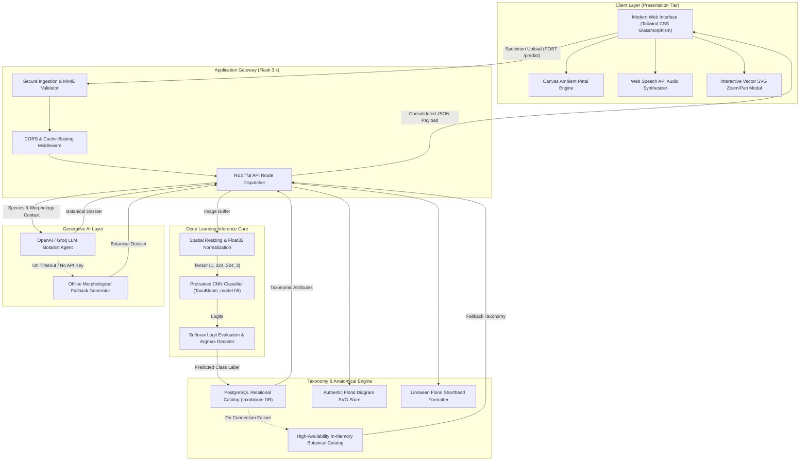
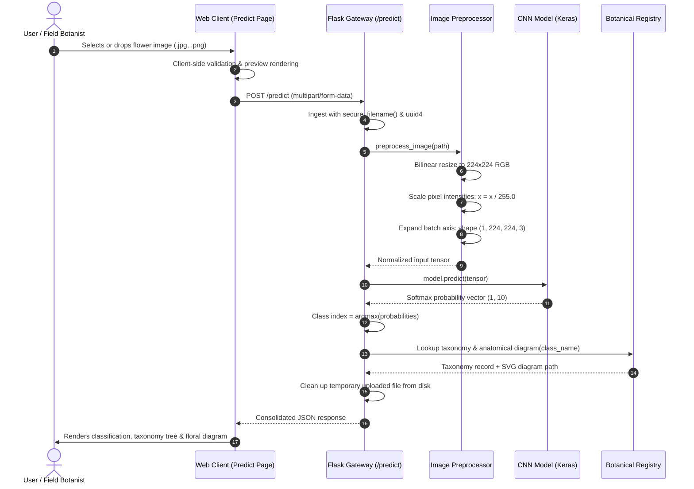
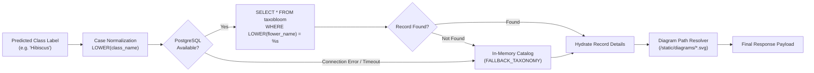
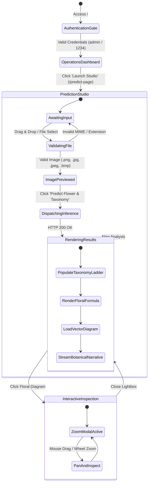
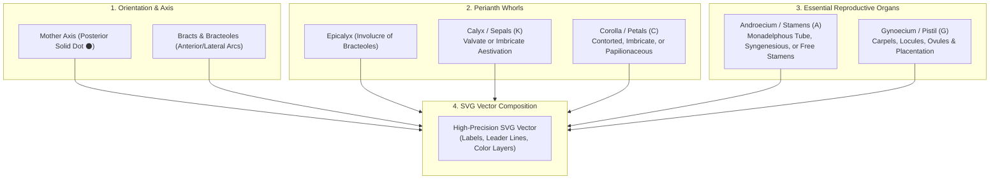
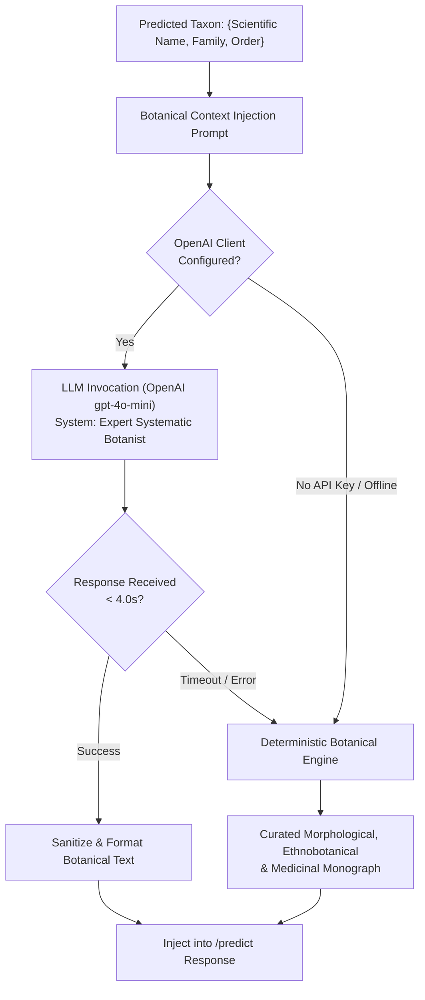

# 🌸 TaxoBloom — Autonomous Botanical Intelligence & Floral Taxonomy System

[](https://www.python.org/)
[](https://www.tensorflow.org/)
[](https://flask.palletsprojects.com/)
[](https://www.postgresql.org/)
[](https://git-lfs.com/)
[](https://tailwindcss.com/)

**TaxoBloom** is an enterprise-grade computational botany platform that unites **Deep Convolutional Neural Networks (CNN)** with **Linnaean Plant Taxonomy** and **Vector Anatomical Graphics**. By analyzing flower specimens captured via digital cameras or field photography, TaxoBloom autonomously classifies the specimen, retrieves its complete 7-tier taxonomic hierarchy from a relational botanical registry, renders an authentic vector floral cross-section diagram, decodes symbolic floral formulas, and synthesizes generative morphological insights.

---

## 📑 Table of Contents

- [1. Executive Summary](#1-executive-summary)
- [2. System Architecture](#2-system-architecture)
- [3. Core Pipelines](#3-core-pipelines)
  - [3.1 Computer Vision & Neural Inference Pipeline](#31-computer-vision--neural-inference-pipeline)
  - [3.2 Botanical Taxonomy & Metadata Retrieval Pipeline](#32-botanical-taxonomy--metadata-retrieval-pipeline)
- [4. Operational Workflows](#4-operational-workflows)
  - [4.1 End-to-End User Interaction Workflow](#41-end-to-end-user-interaction-workflow)
  - [4.2 Vector Floral Diagram & Anatomical Synthesis Workflow](#42-vector-floral-diagram--anatomical-synthesis-workflow)
  - [4.3 Generative AI Botanical Intelligence Workflow](#43-generative-ai-botanical-intelligence-workflow)
- [5. Supported Botanical Taxa](#5-supported-botanical-taxa)
- [6. API Reference & Contract](#6-api-reference--contract)
- [7. Repository & File Structure](#7-repository--file-structure)
- [8. Installation & Deployment Guide](#8-installation--deployment-guide)
- [9. Robustness & Security Provisions](#9-robustness--security-provisions)

---

## 1. Executive Summary

Traditional plant identification relies heavily on dichotomous identification keys, manual morphological dissections, and specialized botanical training. **TaxoBloom** bridges the gap between field observation and rigorous botanical science through an automated, multi-tiered pipeline:

1. **Computer Vision Ingestion**: Transforms raw photographic inputs into standardized $224 \times 224 \times 3$ tensors for neural classification.
2. **Deep CNN Classification**: Evaluates morphological features to identify taxa across 10 botanically significant floral species.
3. **7-Tier Linnaean Classification Retrieval**: Fetches structured phylogenetic taxonomy (`Kingdom` $\to$ `Division` $\to$ `Class` $\to$ `Order` $\to$ `Family` $\to$ `Genus` $\to$ `Species`).
4. **Authentic Vector Floral Diagrams**: Generates and serves cross-sectional anatomical diagrams illustrating whorl morphology (mother axis, calyx aestivation, corolla symmetry, androecium cohesion, gynoecium locules, and placentation).
5. **Botanical Formula Synthesis**: Decodes Linnaean floral shorthand (e.g., $\oplus \ \text{\textdied} \ \text{K}_{(5)} \ \text{C}_5 \ \text{A}_{(\infty)} \ \text{G}_{(5)}$).
6. **Generative LLM Insights**: Augments quantitative predictions with conversational morphological, ecological, and medicinal summaries.

---

## 2. System Architecture

TaxoBloom utilizes a modular, decoupled client-server architecture designed for high availability, sub-second inference latency, and fault tolerance.



### Architectural Subsystems

| Layer | Technologies | Responsibilities |
| :--- | :--- | :--- |
| **Presentation Tier** | HTML5, Tailwind CSS, Canvas API, Web Speech API | Responsive glassmorphic layout, drag-and-drop ingestion, audio narration, interactive diagram lightbox inspection. |
| **Application Gateway** | Python Flask, Werkzeug, Flask-CORS | Secure file handling, MIME verification, no-cache headers (`no-store, must-revalidate`), error boundaries. |
| **Inference Engine** | TensorFlow, Keras, NumPy, Pillow | $224 \times 224 \times 3$ tensor processing, feedforward convolutional classification, probability distribution extraction. |
| **Taxonomic Registry** | PostgreSQL (`psycopg2-binary`), In-Memory Cache | Querying 7-tier Linnaean classifications, floral formulas, and anatomical diagram path references. |
| **Vector Diagram Engine** | SVG (Scalable Vector Graphics), Python Generators | Precision geometric rendering of botanical floral whorls (mother axis, calyx, corolla, androecium, gynoecium). |
| **Generative AI Layer** | OpenAI SDK (`gpt-4o-mini`), Groq Llama 3.3 | Automated generation of structured morphological, ecological, and pharmacological botanical profiles. |

---

## 3. Core Pipelines

### 3.1 Computer Vision & Neural Inference Pipeline

The deep learning inference pipeline receives an arbitrary photographic specimen and converts it into a class prediction through mathematical transformation and convolutional feature extraction.



#### Mathematical Formulation

1. **Spatial Ingestion & Downsampling**:
   $$\mathbf{I}_{\text{raw}} \in \mathbb{R}^{H \times W \times C} \xrightarrow{\text{Bilinear Resample}} \mathbf{I}_{224} \in \mathbb{R}^{224 \times 224 \times 3}$$

2. **Pixel Intensity Normalization**:
   $$\mathbf{X} = \frac{1}{255.0} \cdot \mathbf{I}_{224}, \quad \mathbf{X} \in [0, 1]^{224 \times 224 \times 3}$$

3. **Batch Dimension Expansion**:
   $$\mathbf{X}_{\text{batch}} = \operatorname{reshape}(\mathbf{X}, (1, 224, 224, 3))$$

4. **Feedforward Convolutional Inference**:
   $$\mathbf{z} = f_{\boldsymbol{\theta}}(\mathbf{X}_{\text{batch}}) \in \mathbb{R}^{10}$$
   $$\hat{y}_i = \frac{e^{z_i}}{\sum_{j=1}^{10} e^{z_j}}, \quad \forall i \in \{1, \dots, 10\}$$

5. **Decision Rule & Confidence Score**:
   $$c^* = \arg\max_{i \in \{1, \dots, 10\}} \hat{y}_i, \quad \text{Confidence} = \hat{y}_{c^*}$$

---

### 3.2 Botanical Taxonomy & Metadata Retrieval Pipeline

Once $c^*$ is identified, TaxoBloom queries the botanical database to extract phylogenetic data and anatomical schematics.



#### Relational Database Schema (`taxobloom` Table)

```sql
CREATE TABLE taxobloom (
    id SERIAL PRIMARY KEY,
    flower_name VARCHAR(100) NOT NULL UNIQUE,
    scientific_name VARCHAR(150) NOT NULL,
    kingdom VARCHAR(100) DEFAULT 'Plantae',
    division VARCHAR(100),
    flower_class VARCHAR(100),
    flower_order VARCHAR(100),
    flower_family VARCHAR(100),
    genus VARCHAR(100),
    species VARCHAR(100),
    floral_formula TEXT,
    floral_diagram VARCHAR(255)
);
```

---

## 4. Operational Workflows

### 4.1 End-to-End User Interaction Workflow



---

### 4.2 Vector Floral Diagram & Anatomical Synthesis Workflow

Botanical floral diagrams represent the ground plan of a flower as a cross-section perpendicular to the floral axis. TaxoBloom generates and serves authentic SVG cross-sections reflecting structural morphology:



#### Anatomical Cross-Section Implementation Details

- **Mother Axis**: Rendered at the top ($\theta = 90^\circ$ posterior position) as a defined circle indicating orientation relative to the stem.
- **Calyx (Sepals)**: Represented as outer arcs with pointed exterior midrib projections; fusion brackets indicate gamosepalous conditions.
- **Corolla (Petals)**: Rendered with authentic aestivation patterns:
  - *Twisted / Contorted*: Sequential overlapping margins (e.g., *Hibiscus*, *Catharanthus*).
  - *Vexillary / Papilionaceous*: Large posterior standard, two lateral wings, and fused anterior keel petals (e.g., *Clitoria*).
  - *Valvate*: Margins touching without overlap (e.g., *Calotropis*).
- **Androecium (Stamens)**: Shows monothecous or dithecous reniform anther lobes, monadelphous fusion rings, or epipetalous adnation.
- **Gynoecium (Carpels)**: Precision multi-locular ovary cross-sections detailing:
  - *Axile Placentation*: Multi-locular syncarpous ovary with central column ovules (*Hibiscus*, *Ixora*).
  - *Parietal / Marginal Placentation*: Unilocular chambers with marginal ovules (*Clitoria*).
  - *Basal / Free-Central Placentation*: Solitary basal ovules (*Sunflower*, *Tridax*).

---

### 4.3 Generative AI Botanical Intelligence Workflow

To provide comprehensive context beyond taxonomic keys, TaxoBloom incorporates an asynchronous botanical intelligence generator:



---

## 5. Supported Botanical Taxa

TaxoBloom classifies 10 botanically significant floral species across major angiosperm clades:

| # | Specimen | Botanical Nomenclature | Family | Order | Floral Formula | Aestivation & Placentation |
|---|---|---|---|---|---|---|
| 1 | **Calotropis** | *Calotropis gigantea* | Apocynaceae | Gentianales | $\oplus \ \text{\textdied} \ \text{K}_5 \ \text{C}_{(5)} \ \text{A}_5 \ \underline{\text{G}}_{(2)}$ | Valvate calyx; Gynostegium; Marginal placentation |
| 2 | **Clitoria** | *Clitoria ternatea* | Fabaceae | Fabales | $\% \ \text{\textdied} \ \text{K}_{(5)} \ \text{C}_{1+2+(2)} \ \text{A}_{(9)+1} \ \underline{\text{G}}_1$ | Vexillary corolla; Diadelphous; Marginal placentation |
| 3 | **Crinum** | *Crinum asiaticum* | Amaryllidaceae | Asparagales | $\oplus \ \text{\textdied} \ \text{P}_{3+3} \ \text{A}_{3+3} \ \overline{\text{G}}_{(3)}$ | Epiphyllous perianth; Inferior ovary; Axile placentation |
| 4 | **Hibiscus** | *Hibiscus rosa-sinensis* | Malvaceae | Malvales | $\oplus \ \text{\textdied} \ \text{Epi}_{5-8} \ \text{K}_{(5)} \ \text{C}_5 \ \text{A}_{(\infty)} \ \underline{\text{G}}_{(5)}$ | Twisted corolla; Monadelphous column; Axile placentation |
| 5 | **Ixora** | *Ixora coccinea* | Rubiaceae | Gentianales | $\oplus \ \text{\textdied} \ \text{K}_{(4)} \ \text{C}_{(4)} \ \text{A}_4 \ \overline{\text{G}}_{(2)}$ | Epipetalous stamens; Inferior ovary; Axile placentation |
| 6 | **Lotus** | *Nelumbo nucifera* | Nelumbonaceae | Proteales | $\oplus \ \text{\textdied} \ \text{K}_{2-5} \ \text{C}_{\infty} \ \text{A}_{\infty} \ \underline{\text{G}}_{\infty}$ | Spiral arrangement; Apocarpous spongy torus receptacle |
| 7 | **Sunflower** | *Helianthus annuus* | Asteraceae | Asterales | $\% \ \text{\textfemale} \ \text{K}_0 \ \text{C}_{(3-5)} \ \text{A}_0 \ \overline{\text{G}}_{(2)}$ (Ray)<br>$\oplus \ \text{\textdied} \ \text{K}_{\text{pappus}} \ \text{C}_{(5)} \ \text{A}_{(5)} \ \overline{\text{G}}_{(2)}$ (Disc) | Capitulum head; Syngenesious; Basal ovule |
| 8 | **Tridax** | *Tridax procumbens* | Asteraceae | Asterales | $\% \ \text{\textfemale} \ \text{K}_{\text{pappus}} \ \text{C}_{(3)} \ \text{A}_0 \ \overline{\text{G}}_{(2)}$ (Ray)<br>$\oplus \ \text{\textdied} \ \text{K}_{\text{pappus}} \ \text{C}_{(5)} \ \text{A}_{(5)} \ \overline{\text{G}}_{(2)}$ (Disc) | Heterogamous capitulum; Pappus calyx; Basal placentation |
| 9 | **Periwinkle** | *Catharanthus roseus* | Apocynaceae | Gentianales | $\oplus \ \text{\textdied} \ \text{K}_5 \ \text{C}_{(5)} \ \text{A}_5 \ \underline{\text{G}}_{(2)}$ | Salverform twisted corolla; Sagittate epipetalous anthers |
| 10 | **Rose** | *Rosa indica* | Rosaceae | Rosales | $\oplus \ \text{\textdied} \ \text{K}_5 \ \text{C}_5 \ \text{A}_{\infty} \ \underline{\text{G}}_{\infty}$ | Imbricate corolla; Polyandrous; Perigynous hypanthium |

---

## 6. API Reference & Contract

### Ingest & Predict Specimen

```http
POST /predict
Content-Type: multipart/form-data
```

#### Parameters

| Field | Type | Required | Description |
| :--- | :--- | :--- | :--- |
| `image` | `File (Binary)` | **Yes** | Input image file (`.png`, `.jpg`, `.jpeg`, `.bmp`). Max recommended size: 16 MB. |

#### Response Schema (`application/json`)

```json
{
  "predicted_label": "Hibiscus",
  "confidence": 0.9842,
  "details": {
    "flower_name": "Hibiscus",
    "scientific_name": "Hibiscus rosa-sinensis",
    "kingdom": "Plantae",
    "division": "Tracheophytes",
    "flower_class": "Magnoliopsida",
    "flower_order": "Malvales",
    "flower_family": "Malvaceae",
    "genus": "Hibiscus",
    "species": "H. rosa-sinensis",
    "floral_formula": "⊕ ⚥ Epk₅₋₈ K₍₅₎ C₅ A₍∞₎ G₍₅₎",
    "floral_diagram": "/static/diagrams/hibiscus_floral_diagram.svg"
  },
  "description": "Hibiscus rosa-sinensis, commonly known as China Rose, features a prominent staminal tube..."
}
```

### Auxiliary Endpoints

| Method | Endpoint | Description | Response Content |
| :--- | :--- | :--- | :--- |
| `GET` | `/` | Web entry portal | HTML (Login Interface) |
| `GET` | `/dashboard` | Operations overview & species catalog | HTML (Dashboard View) |
| `GET` | `/predict-page` | Live botanical classification studio | HTML (Studio Studio View) |
| `GET` | `/classes` | Enumerates supported botanical classes | JSON array of 10 class records |
| `GET` | `/static/diagrams/<name>.svg` | Direct vector anatomical diagram asset | Scalable Vector Graphics (XML) |

---

## 7. Repository & File Structure

```text
TaxoBloom/
├── .env.example                       # Reference environment configuration
├── .gitignore                         # Git tracking exceptions (secrets, binaries, caches)
├── .gitattributes                     # Git LFS configuration (*.h5 filter & diff tracking)
├── README.md                          # Comprehensive system architecture & developer guide
├── requirements.txt                   # Production Python package manifest
│
├── app.py                             # Core Flask application, REST gateway & prediction logic
├── class_names.json                   # 10 botanical class labels in model output index order
├── TaxoBloom_model.h5                 # Pretrained Keras CNN weights (tracked via Git LFS)
├── llm.py                             # Generative botanical profile builder (OpenAI / Groq)
├── model.ipynb                        # CNN training, validation, and evaluation notebook
│
├── static/                            # Frontend assets & views
│   ├── login.html                     # Authentication gateway with demo autofill
│   ├── dashboard.html                 # Metrics dashboard, species hub & live carousel
│   ├── index.html                     # Studio view: specimen upload, ladder & diagram viewer
│   ├── logo.svg                       # Vector brand identity mark
│   │
│   └── diagrams/                      # Authentic botanical vector floral cross-sections
│       ├── calotropis_floral_diagram.svg
│       ├── clitoria_floral_diagram.svg
│       ├── crinum_floral_diagram.svg
│       ├── hibiscus_floral_diagram.svg
│       ├── ixora_floral_diagram.svg
│       ├── lotus_floral_diagram.svg
│       ├── periwinkle_floral_diagram.svg
│       ├── rose_floral_diagram.svg
│       ├── sunflower_floral_diagram.svg
│       ├── tridax_floral_diagram.svg
│       ├── make_hibiscus.py           # Hibiscus vector geometry generator
│       └── generate_all_diagrams.py   # Full-spectrum floral diagram generator
│
└── tmp_uploads/                       # Temporary ephemeral ingestion directory
```

---

## 8. Installation & Deployment Guide

### 8.1 Prerequisites

- **Python Runtime**: Python `3.10`, `3.11`, or `3.13`.
- **Git & Git LFS**: Ensure Git Large File Storage is installed (`git lfs --version`).
- **PostgreSQL Database** *(Optional)*: Version 12+ (System includes automatic in-memory fallback).

### 8.2 Repository Cloning & LFS Setup

```bash
# Clone the repository
git clone https://github.com/Akshitha-Veepanjeri-G/Taxobloom.git
cd Taxobloom

# Initialize Git LFS and pull model weights
git lfs install
git lfs pull
```

### 8.3 Virtual Environment Setup

#### Windows (PowerShell)

```powershell
python -m venv .venv
.\.venv\Scripts\Activate.ps1
pip install --upgrade pip
pip install -r requirements.txt
```

#### Linux / macOS

```bash
python3 -m venv .venv
source .venv/bin/activate
pip install --upgrade pip
pip install -r requirements.txt
```

### 8.4 Environment Configuration

Copy the sample environment file and configure variables:

```bash
cp .env.example .env
```

Edit `.env`:

```ini
MODEL_PATH=TaxoBloom_model.h5
UPLOAD_DIR=tmp_uploads
STATIC_DIR=static

# PostgreSQL Configuration (Optional - High-availability fallback active by default)
PG_HOST=localhost
PG_DB=taxobloom_new
PG_USER=postgres
PG_PASS=your_secure_password
PG_PORT=5432

# OpenAI Configuration (Optional - Offline deterministic fallback active by default)
OPENAI_API_KEY=your_openai_api_key_here
```

### 8.5 Running the Application

```bash
python app.py
```

Console output will verify model initialization:

```text
[INFO] Loading ML model...
[INFO] Model loaded.
 * Serving Flask app 'app'
 * Debug mode: off
 * Running on http://127.0.0.1:5000
```

Access the application in your browser at **`http://127.0.0.1:5000`**.  
Default authentication credentials:
- **Username:** `admin`
- **Password:** `1234`

---

## 9. Robustness & Security Provisions

1. **Dual-Tier Knowledge Resilience**: Database queries wrap around a structured fallback dictionary (`FALLBACK_TAXONOMY`). Network partition or database downtime never prevents user access to taxonomy or diagrams.
2. **Ephemeral File Lifecycle**: Uploaded specimen files are written to `tmp_uploads/` using UUID-based filenames and securely removed immediately after the forward pass completes.
3. **MIME & Extension Enforcement**: Only verified image formats (`.png`, `.jpg`, `.jpeg`, `.bmp`) pass through the ingestion barrier.
4. **Cache Invalidation Middleware**: Flask response interceptors inject HTTP `Cache-Control: no-cache, no-store, must-revalidate` headers to ensure vector diagrams and UI components always reflect the latest live state.
5. **Secrets Isolation**: All database credentials and API tokens reside in `.env`, strictly ignored by version control.

---

## 📄 License & Attribution

TaxoBloom is developed for academic research, education, and systematic botany exploration.  
Phylogenetic data adheres to the **Angiosperm Phylogeny Group IV (APG IV)** classification standards.
